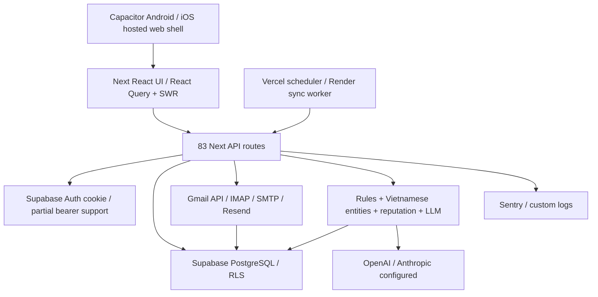

# M0 repository audit

Source revision `240d9e1`; audit date 2026-11-11. Initial tree: 442 tracked files,
83 Next API route files, 8 versioned migrations, no CI workflow, no test script.
No production, user metrics, secrets or real mailboxes inspected.

## Coverage and limits
Repository-wide inventory and import/query scans cover tracked text files. Deep
review focuses on OAuth, cron, service-role queries, Supabase policies, sync/send,
AI boundaries and deployment. This is not a claim of manual line-by-line review
of all components or a penetration test. Full behavior and native builds remain
unverified. The three historical test files use custom runners and partly test
local constants rather than production behavior; they do not establish accuracy.

## Dependency map

Reuse candidates: Vietnamese rules/entities, classifier stages, feature allocation,
source adapters, email sanitization, existing list/detail components and query hooks.
Reuse is conditional on tests; duplication alone is not a reason to rewrite.
Classifier/classifier-updated, two search parsers, overlapping sync endpoints,
two token conventions, multiple email list/detail and theme/haptics hooks increase
change cost. Consolidate one boundary at a time after its behavior is captured.

## Risk matrix and technical debt register

Likelihood is qualitative source-based exposure, not observed exploit frequency.

| ID | Severity / likelihood | Evidence at baseline | Action / dependency |
| --- | --- | --- | --- |
| SEC-01 | Critical / high | Both Google callbacks accept missing/invalid state; Base64 is forgeable; one does not check age | M0 mandatory browser/user/flow state and PKCE, negative route tests |
| SEC-02 | Critical / high | All five cron routes check secret only if configured | M0 shared fail-closed guard before DB/provider work |
| SEC-03 | Critical / high | emails/send service-role reply lookups omit user_id | M0 reject foreign reply ID before SMTP or trust changes |
| SEC-04 | Critical / high | source_accounts RLS permits reading plaintext tokens via direct API; two token families | M1 server credential boundary/vault, key rotation and migration; blocks real email |
| SEC-05 | Critical / medium | set_primary_account is SECURITY DEFINER trusting p_user_id; profiles own-row writes include is_admin | M0 invoker RPC and protected admin flag; SQL role tests |
| SEC-06 | High / high | admin/ai-settings upsert spreads request body after authenticated user_id | M0 allowlist settings and pin tenant after validation |
| SEC-07 | Critical / high | npm audit: 77 findings, 6 critical, 27 high; old Next and React lock | Scoped dependency remediation + compatibility validation; blocks release |
| SEC-08 | High / medium | Resend signature manually computes wrong Svix format and skips if secret absent | M0 official SDK verification, missing/invalid/replay-window tests |
| SEC-09 | High / medium | RLS own-row checks do not establish same-tenant foreign references | M0 restrictive reference policies + two-tenant SQL tests; service-role still needs predicates |
| SEC-10 | Critical / medium | Whitelist admin trusts a fixed email, protectedRoute trusts an email suffix; signup auto-confirms arbitrary email input | M0 server-managed app_metadata role; existing administrator needs explicit metadata provisioning before rollout |
| AUTH-01 | High / medium | Public signup auto-confirms email; caps/listUsers are not a transactional admission mechanism | Before real signup: verified-email onboarding and rate/admission policy, tested with isolated Supabase auth configuration |
| SYNC-01 | High / high | Gmail single page and timestamp cursor advanced after failed inserts/fetches | M1 paginated initial/history sync, durable checkpoints, targeted retry |
| SYNC-02 | High / high | upsert source_account_id/original_uid index exists only in root SQL, not migration chain | M1 canonical constraints/preflight/backfill; fresh-install tests |
| SYNC-03 | High / high | add-account writes auth_type oauth/provider google; sync expects oauth_google | M1 adapter contract and both entry-point tests |
| SEND-01 | High / high | Gmail OAuth account sent through password SMTP route | M1 Gmail OAuth send + request idempotency and reconciliation |
| CRYPTO-01 | High / medium | IMAP AES-CBC unauthenticated; key pad/truncate uses text rather than decoded hex | M1 versioned AEAD envelope and legacy migration, no blind key reinterpretation |
| DB-01 | High / high | Fresh schema misses fields expected by routes; loose root SQL; follow-up schemas conflict | M0 execute fresh migration chain; M1 reconcile tracked schema with deployed metadata |
| AI-01 | Medium / high | Heuristic confidence and static cost estimates | Capture real token usage; held-out direct LLM/agent comparison, no quality claims |
| AI-02 | High / medium | Phishing allowlist reduces risk cap; unsubscribe often only local filtering | Do not market security guarantee or actual unsubscribe without evidence |
| OPS-01 | High / medium | In-memory rate limiting; distributed workers; no durable overlap lease | M0 document exposure; M1 shared throttling/leases as measured need |
| OPS-02 | High / high | Render autoDeploy true; domains disagree with Capacitor; Vercel function paths lack src/app | Block auto deployment for this branch; reconcile config before staging |
| QA-01 | High / high | lint 27 errors/109 warnings; no npm test; build eagerly requires credentials | M0 test runner + CI, record baseline, use synthetic build-only env |
| UX-01 | Medium / high | Existing palette/fonts differ from new standard; React hook violations | M2 gradual tokens/components + responsive a11y verification |

## Refactor strategy
1. Capture baseline and security regression cases before structural work.
2. Close request-boundary vulnerabilities within existing routes; keep schemas and
   provider conventions stable until migrations and compatibility tests exist.
3. Centralize credentials/adapters and sync state in M1 before any real email.
4. Reuse UI primitives with token changes in M2; ledger/retrieval/operator consume
   trusted tenant-scoped evidence through explicit contracts in M3-M5.
5. Use held-out user tasks to decide whether additional orchestration earns its cost.

Security rationale references checked on 2026-11-11:
[OAuth BCP](https://www.rfc-editor.org/rfc/rfc9700.html),
[Supabase RLS](https://supabase.com/docs/guides/database/postgres/row-level-security).
They inform controls, not a certification that this application complies.

## Implemented M0 disposition
SEC-01/02/03/05/06/08/09/10 have targeted patches and local regression evidence.
This is scoped closure of the identified paths, not a claim every route is secure.
The fresh-schema NUMERIC phishing-score trigger dispatch error was reproduced
in PostgreSQL and repaired with a numeric overload without rescaling stored data.
The score column still has legacy type/scale inconsistencies; classification
quality and deployed data require a separate migration decision.

SEC-07: compatibility updates, removal of unused `imap`/types and explicit
Nodemailer 10.5 / Sharp 0.35.5 upgrades remove scanned high/critical dependency
findings. Eleven moderate findings remain in the captured audit, including
development tooling/transitive dependencies. This does not prove absence of
unreported vulnerabilities. Nodemailer composition and Sharp encoding were tested
locally without mail delivery or external assets.

QA-01: added Vitest and real-PG integration harness, CI workflow and deterministic
build-only configuration. Repaired existing lint errors rather than disabling rules:
conditional hooks, components declared during render, hydration/effect state cascades,
toast declaration order, unknown error typing, scheduler module imports and performance
memory typing. UI tests cover the affected hydration/media/network/theme/modal/summary
paths. These changes preserve the existing palette/layout; M2 design remains pending.

Render blueprint now specifies lockfile installation and disabled auto deploy;
no deployed Render settings were accessed or changed. Remote CI execution, branch
protection, real provider behavior, credential vault, signup verification, deployed
schema upgrade, sync durability and native/a11y/performance certification remain open.

## M1-A local remediation update (2026-11-11)

SEC-04: public secret columns and duplicate hot-read token conventions are removed
by the new forward migration; server-only AEAD, private grants, tenant-bound RPCs,
legacy conversion/quarantine, rotation and encrypted restore are verified locally.
This mitigates the identified browser credential-read path in the tested schema.
Hosted migration/key custody/backup handling remain unverified; real-mail gate stays
closed. See CREDENTIAL_VAULT.md and M1A_LOCAL_HANDOFF.md.

The bounded prior encrypted envelope and conflicted private legacy packets need a
release retention policy. CBC input cannot be retroactively authenticated. Managed
key delivery, provider revalidation and fleet cutover are still release work.
M1-B sync durability and M1-C Gmail OAuth send/idempotency are unchanged open debts.
Current lint debt is 103 warnings (0 errors); dependency audit remains 11 moderate
findings, no high/critical findings in the observed audit. Sentry's config-import
deprecation is still reported by the successful build. No AI quality, commercial
advantage, performance benchmark or hosted security certification is inferred.
